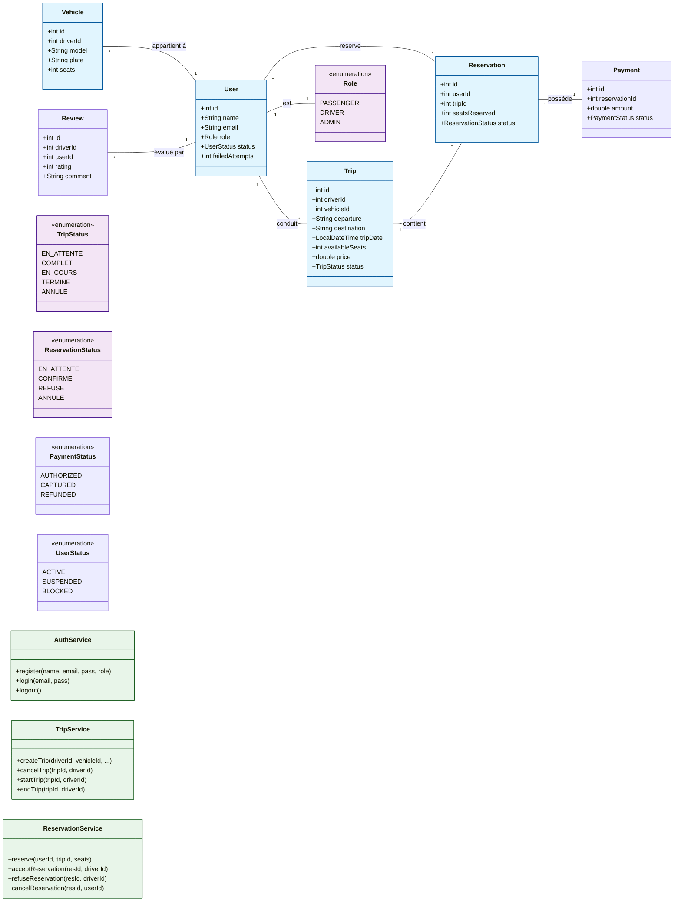

# Diagramme de Classe UML - Carpooling App

## Description du Diagramme

Ce diagramme illustre l'architecture complète du projet de covoiturage. 

1.  **Le Cœur du Système** : L'entité `User` est centrale, pouvant être un `PASSENGER`, un `DRIVER` ou un `ADMIN`.
2.  **Gestion des Trajets** : Un conducteur (`DRIVER`) crée un `Trip` avec un `Vehicle` spécifique.
3.  **Processus de Réservation** : Un passager effectue une `Reservation`. Celle-ci passe par différents états (`EN_ATTENTE`, `CONFIRME`) gérés par le `ReservationService`.
4.  **Paiement et Évaluation** : Une fois confirmée, une réservation génère un `Payment`. Après le trajet, l'utilisateur peut laisser une `Review`.
5.  **Services** : Ils encapsulent toute la logique de validation (ex: vérifier s'il reste des places avant de confirmer).
